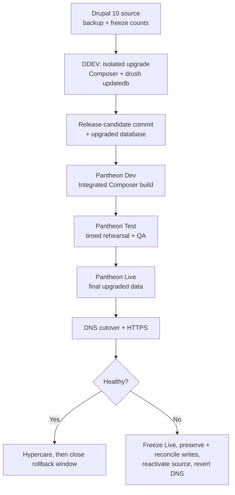

# Drupal 10 → Drupal 11 on Pantheon

**Migration runbook and practice lab** · DDEV · Composer · Drush 13 · Git · Pantheon Terminus

[](https://github.com/anisur-rahman/drupal10-to-drupal11-pantheon-migration/actions/workflows/validate-docs.yml)

A 33-step procedure for upgrading a Composer-managed Drupal 10 site to Drupal 11 and moving it to Pantheon. It covers a rehearsed cutover, data reconciliation and a rollback that does not lose post-launch writes. It comes with read-only verification scripts and phase checklists.

> **Status: reference runbook / practice lab.** The procedures follow the official Drupal and Pantheon documentation. They were not produced from a live government migration. The example agency (`www.agency.example`, site `drupal11-migration-demo`) is **fictional**. The scripts pass `bash -n` and ShellCheck in CI. The local workflow (readiness → backup → upgrade → verify → reconcile → smoke test) was run end to end in the [demo lab](docs/09-demo-lab.md) on Drupal 10.6 → 11.4. Pantheon-facing commands must be validated against your own sandbox before production use, because platform behavior and Terminus options change.

## Architecture



**Core principles**

1. **The code is upgraded once. The database is upgraded on every run.** The release-candidate commit is fixed in Step 12. Every later database (Dev, Test, final) is upgraded with `drush updatedb` against that exact code.
2. **Numbers, not impressions.** Content counts and highest IDs are captured at the baseline, after the upgrade, at the freeze and on Live, and compared automatically.
3. **Rehearse the cutover.** The final run repeats the timed Test rehearsal with fresh data.
4. **Rollback is a data operation.** Freeze, preserve and reconcile happen before DNS moves back.

## Repository structure

```
drupal10-to-drupal11-pantheon-migration/
│
├── README.md                          # Overview, architecture, 33-step index (this file)
├── LICENSE                            # MIT
├── .gitignore                         # Blocks dumps, archives, keys, .env, vendor/
│
├── docs/                              # Step-by-step procedures
│   ├── 01-discovery.md                # Steps 1–4    access, inventory, Drupal 11 blockers
│   ├── 02-backup-local-setup.md       # Steps 5–6    checksummed backup, DDEV restore
│   ├── 03-drupal11-upgrade.md         # Steps 7–12   Composer upgrade, updatedb, release candidate
│   ├── 04-pantheon-setup.md           # Steps 13–18  site, pantheon.yml, scaffold merge, build
│   ├── 05-database-files-migration.md # Steps 19–22  signed-URL imports, private files
│   ├── 06-testing-qa.md               # Steps 23–25  Test deploy, rehearsal, sign-off
│   ├── 07-production-cutover.md       # Steps 26–31  freeze, final upgrade, Live, DNS
│   ├── 08-monitoring-rollback.md      # Steps 32–33  hypercare, data-safe rollback
│   ├── 09-demo-lab.md                 # Hands-on practice on a throwaway site
│   └── 10-troubleshooting.md          # Symptom → diagnosis → fix tables
│
├── scripts/                           # Bash tools (PASS/WARN/FAIL output, --help)
│   ├── lib/
│   │   └── common.sh                  # Shared helpers, Drush/Composer detection
│   ├── check-requirements.sh          # Workstation prerequisites
│   ├── drupal11-readiness.sh          # Pre-upgrade audit of a Drupal 10 site
│   ├── backup-drupal.sh               # DB + files + manifest + SHA-256
│   ├── verify-upgrade.sh              # Post-upgrade verification
│   ├── reconcile-counts.sh            # Capture / compare content counts
│   ├── smoke-test.sh                  # HTTP checks
│   ├── pantheon-health-check.sh       # Pantheon environment health
│   └── pantheon-import.sh             # Guarded DB/files import (destructive)
│
├── checklists/
│   ├── pre-migration.md
│   ├── qa-acceptance.md
│   ├── production-cutover.md
│   └── rollback.md
│
├── examples/
│   ├── pantheon.yml                   # PHP 8.3, MariaDB 10.6
│   ├── environment.example            # Shell variables used in the runbook
│   └── smoke-paths.example            # Paths file for smoke-test.sh
│
└── .github/
    └── workflows/
        └── validate-docs.yml          # bash -n, ShellCheck, links, all-33-steps check
```

## The 33 steps

| Phase | Steps | What happens | Doc |
|---|---|---|---|
| Discovery | 1–4 | Access, inventory, Drupal 11 blocker audit | [01 · Discovery](docs/01-discovery.md) |
| Backups and local setup | 5–6 | Checksummed backup, DDEV restore, baseline counts | [02 · Backups](docs/02-backup-local-setup.md) |
| Drupal 11 upgrade | 7–12 | Fix blockers, Composer upgrade, `updatedb`, test, release candidate | [03 · Upgrade](docs/03-drupal11-upgrade.md) |
| Pantheon setup | 13–18 | Site creation, `pantheon.yml`, merge into scaffold, green build | [04 · Pantheon](docs/04-pantheon-setup.md) |
| Data and files | 19–22 | Signed-URL imports, private files, Dev verification | [05 · Data migration](docs/05-database-files-migration.md) |
| Testing and QA | 23–25 | Deploy to Test, timed rehearsal, QA and sign-off | [06 · QA](docs/06-testing-qa.md) |
| Production cutover | 26–31 | Freeze, final upgrade, Live import, go/no-go, DNS | [07 · Cutover](docs/07-production-cutover.md) |
| Monitoring and rollback | 32–33 | Hypercare signals, data-safe rollback | [08 · Rollback](docs/08-monitoring-rollback.md) |

Also: [09 · Demo lab](docs/09-demo-lab.md) (practice the whole flow on a throwaway site) and [10 · Troubleshooting](docs/10-troubleshooting.md).

## Scripts

All scripts are bash (3.2+ compatible), print PASS/WARN/FAIL lines, exit non-zero on failure, and accept `--help`. Drush and Composer are auto-detected. You can also set them explicitly, for example `DRUSH="ddev drush"` or `DRUSH="terminus drush SITE.ENV --"`.

| Script | Purpose | Changes data? |
|---|---|---|
| [`check-requirements.sh`](scripts/check-requirements.sh) | Workstation prerequisites: Docker, DDEV, PHP/Composer versions, Terminus auth, SSH key | No |
| [`drupal11-readiness.sh`](scripts/drupal11-readiness.sh) | Drupal 10.3+, PHP 8.3, MariaDB 10.6 / MySQL 8.0, removed core modules, custom `info.yml`, Composer blockers, Upgrade Status | No |
| [`backup-drupal.sh`](scripts/backup-drupal.sh) | DB + public/private files + manifest + SHA-256. Refuses to write inside a Git repo | Writes backup files only |
| [`verify-upgrade.sh`](scripts/verify-upgrade.sh) | Bootstrap, major version, pending updates, config drift, status-report errors, log errors, cron | No |
| [`reconcile-counts.sh`](scripts/reconcile-counts.sh) | Capture content counts and highest IDs. `--compare` two captures | No |
| [`smoke-test.sh`](scripts/smoke-test.sh) | HTTP status, error text, response time, 404 and HTTPS redirect checks | No |
| [`pantheon-health-check.sh`](scripts/pantheon-health-check.sh) | Environment info, connection mode, workflows, backups, domains, plus the two checks above | No |
| [`pantheon-import.sh`](scripts/pantheon-import.sh) | **Guarded** DB/files import: backup first, typed confirmation, `ALLOW_LIVE=yes` for Live, redacts signed URLs | **Yes** |

## Quick start

```bash
git clone https://github.com/anisur-rahman/drupal10-to-drupal11-pantheon-migration.git
cd drupal10-to-drupal11-pantheon-migration

# macOS prerequisites (start Docker Desktop, OrbStack or Colima first)
brew install git jq ddev/ddev/ddev
brew install pantheon-systems/external/terminus        # or follow docs.pantheon.io/terminus/install
scripts/check-requirements.sh

# From your Drupal project root:
DRUSH="ddev drush" COMPOSER_CMD="ddev composer" /path/to/this/repo/scripts/drupal11-readiness.sh
```

New to the flow? Start with the [demo lab](docs/09-demo-lab.md). It builds a Drupal 10 site with a deliberate Drupal 11 blocker and walks through fixing it.

## Safety

- Never commit database dumps, files, private keys, machine tokens or `settings.local.php`. `.gitignore` covers the common cases, and `backup-drupal.sh` refuses to write inside a Git work tree.
- `terminus import:*` and `env:clone-content` **overwrite** the target. Take a backup first (`pantheon-import.sh` does this).
- Host transfer files only at short-lived, signed HTTPS URLs, and delete them afterwards.
- Keep the old host frozen, not writable, until the rollback window closes.
- Pantheon plans, sandbox terms and size limits change. Check them before you plan.

## References

- [Drupal: upgrading from Drupal 10 to 11](https://www.drupal.org/docs/upgrading-drupal/upgrading-drupal/how-to-upgrade-from-drupal-10-to-drupal-11)
- [Drupal 11 system requirements](https://www.drupal.org/docs/getting-started/system-requirements)
- [Upgrade Status module](https://www.drupal.org/project/upgrade_status)
- [Pantheon: migrate a Composer-managed Drupal site](https://docs.pantheon.io/guides/drupal-unhosted-composer)
- [Pantheon: Integrated Composer](https://docs.pantheon.io/guides/integrated-composer)
- [Pantheon: pantheon.yml](https://docs.pantheon.io/pantheon-yml)
- [Pantheon: Terminus commands](https://docs.pantheon.io/terminus/commands)
- [DDEV documentation](https://ddev.readthedocs.io/)

## License

MIT for the original documentation and scripts in this repository. Drupal, Pantheon and other third-party components keep their own licenses.
