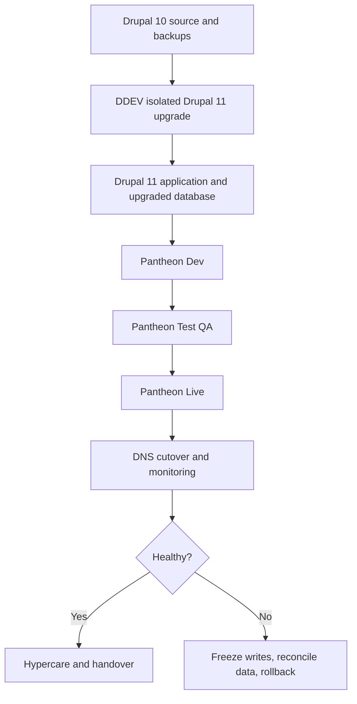

# Drupal 10 → Drupal 11 on Pantheon

**Enterprise-style migration lab and operational runbook** · DDEV · Composer · Drush · Git · Pantheon Terminus

> **Status: Reference implementation / practice runbook.** The commands are documented examples, not proof that a live migration was performed. Replace placeholders and validate your versions before running destructive operations.

## Goal
Upgrade a Composer-managed Drupal 10 website to Drupal 11 in an isolated environment, migrate its tested code, database and files to Pantheon, validate Dev/Test/Live, and rehearse production cutover and rollback.

## Architecture



## 33-step walkthrough

| Phase | Steps | Documentation |
|---|---|---|
| Discovery | 1–4 | [01 Discovery](docs/01-discovery.md) |
| Backups and local setup | 5–6 | [02 Backups and local setup](docs/02-backup-local-setup.md) |
| Drupal 11 upgrade | 7–12 | [03 Drupal upgrade](docs/03-drupal11-upgrade.md) |
| Pantheon setup | 13–18 | [04 Pantheon setup](docs/04-pantheon-setup.md) |
| Data and files | 19–22 | [05 Data migration](docs/05-database-files-migration.md) |
| QA | 23–25 | [06 Testing and QA](docs/06-testing-qa.md) |
| Production cutover | 26–31 | [07 Cutover](docs/07-production-cutover.md) |
| Monitoring and rollback | 32–33 | [08 Rollback](docs/08-monitoring-rollback.md) |

## Quick start

```bash
# Mac prerequisites
brew install git php composer jq
brew install ddev/ddev/ddev
# Start Docker Desktop first
docker info
ddev version
# Authenticate to Pantheon after installing Terminus per official docs
terminus auth:login
```

For a fresh local practice site, see [Demo lab](docs/09-demo-lab.md). For safe read-only checks, see [scripts](scripts/).

## Safety
- Never store production dumps, uploaded private files, SSH keys, machine tokens, or real secrets in Git.
- Pantheon database imports and content clones overwrite destination data.
- Drupal 10 production database must be upgraded against compatible Drupal 11 code before importing into Drupal 11 Live.
- Use change approval, content freeze, reconciliation and a tested rollback before production cutover.
- Pantheon sandbox features and trial terms can change; verify current plan limits.

## References
- [Drupal 10 → 11 upgrade](https://www.drupal.org/docs/upgrading-drupal/upgrading-drupal/how-to-upgrade-from-drupal-10-to-drupal-11)
- [Pantheon Composer-managed migration](https://docs.pantheon.io/guides/drupal-unhosted-composer)
- [Pantheon Terminus](https://docs.pantheon.io/terminus/commands)
- [Pantheon configuration](https://docs.pantheon.io/pantheon-yml)

## License
MIT for the original documentation and scripts in this repository. Third-party Drupal and Pantheon components retain their respective licenses.
